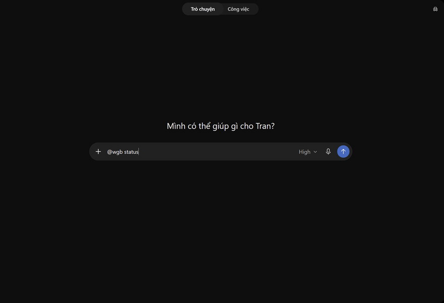

<div align="center">

# webchat-goal-bridge (wgb)

**Turn a logged-in ChatGPT / Gemini / Claude tab into a remote control for your
local coding agent — and get the result posted back into the same chat for review.**

[](LICENSE)
[](package.json)
[](package.json)
[](#quick-start)
[](#contributing)

[English](README.md) · [Tiếng Việt](README.vi.md)

*No API keys. No new subscriptions. The web chat you already use becomes the
brain; a local agent becomes the hands — with a closed review loop between them.*

</div>

<!-- ▶ Demo: drop a short GIF at docs/demo.gif and uncomment:

-->

---

## Why?

Frontier models in web chat — **including free tiers** — are excellent planners
and reviewers, but they can't touch your machine. Local coding agents can
execute, but you lose the conversation-driven loop where you (or the chat
itself) direct, inspect and accept the work.

**wgb stitches the two together:**

```
You + web chat (the brain)  ──@bridge <task>──►  wgb  ──►  local runner (the hands)
        ▲                                                        │
        └────────── "[wgb] Goal <id>: <result>" ─────────────────┘
                     posted back into the same chat for review
```

Unlike most bridges, it is **two-way with an acceptance loop**, and it was built
around the failure modes that kill similar projects in practice: platform
throttling, DOM drift, and reply echo-loops.

## How it works

```
 You (ChatGPT / Gemini / Claude web tab, already logged in)
        │  types:  @bridge <task>          (or @wgb via the extension)
        ▼
┌───────────────────────────────────────────────────────────┐
│ webchat-goal-bridge                                       │
│  ① detect new trigger message (CDP watch / extension)     │
│  ② security gate: denylist + workspace allowlist          │
│  ③ runner: echo │ exec │ opencode │ inbox                 │
│  ④ type + send "[wgb] Goal <id>: <result>" back           │
└───────────────────────────────────────────────────────────┘
        │ (runner = inbox)                        ▲
        ▼                                         │ reply_*.md
  data/inbox/goal_*.json ──► ANY local agent ─────┘
```

Goals move through a small state machine (`queued → running → done/failed`,
stored in `data/goals.json`), so you can inspect every run with
`node src/cli.js goals`.

## Requirements

- **Node ≥ 22** (global `fetch` / `WebSocket` — zero npm dependencies, no `npm install`)
- **Brave** (any Chromium works for the CDP flow; `brave on/off` assumes Brave by default)
- Windows for the one-click `.bat` helpers; the core CLI is plain ESM Node and should run anywhere

## Quick start

### A — Integrated goal loop (CDP watch, ChatGPT / Gemini)

```bash
git clone https://github.com/kh4i-dev/webchat-goal-bridge
cd webchat-goal-bridge
cp config.example.json config.json      # Windows: copy config.example.json config.json

node src/cli.js brave on                # relaunches Brave with a TEMPORARY CDP port, keeps your login session
node src/cli.js probe --platform chatgpt   # verifies login + composer
node src/cli.js watch --platform chatgpt   # starts the goal loop
```

Then type in the chat tab:

```
@bridge list the TODOs in this repo and write them to TODO.md
@bridge status          ← inspect running goals without spending tokens
```

When you're done: `node src/cli.js brave off` (always closes the CDP port).

### B — Extension mode (adds claude.ai)

The `wgb-companion` MV3 extension listens **inside the chat tabs** and dispatches
tasks over HTTP to `wgb serve` — no CDP needed, and it works on
chatgpt.com, gemini.google.com **and claude.ai**.

1. Start the control plane: `node src/cli.js serve` → listens on `127.0.0.1:8787`
   and auto-generates an auth token into `config.json`.
2. Brave → `brave://extensions` → enable **Developer mode** → **Load unpacked** → select `extension/`.
3. Open a chat tab — a `wgb` pill appears bottom-right. Paste the token from `config.json` into the popup.
4. Type `@wgb <task>` (or `@wgb status`) in the chat. Results are typed + sent back automatically.

### C — Standalone file watcher (harness-agnostic)

`gemini_cdp_watcher.mjs` is a single-file bridge with a pure **file protocol**:
new messages become `inbox/goal_*.json`, any agent that writes `outbox/reply_*.md`
gets its reply typed + sent into the chat. Use it when your agent can't call
HTTP or the CLI — it only needs filesystem access.

## Runners

Pick one in `config.json`:

```json
{ "runner": { "type": "inbox", "inbox": "data/inbox", "outbox": "data/outbox", "timeoutMs": 900000 } }
```

| Runner | Behavior |
| :--- | :--- |
| `echo` | Returns the task text — tests the full loop at zero cost |
| `exec` | Runs `cfg.runner.command` with `{task}` substituted (scripts, test suites) |
| `opencode` | Calls `opencode run "<task>"` inside `cfg.runner.cwd` — a real coding harness |
| `inbox` | Writes a goal JSON to `data/inbox/`, waits for `reply_*.md` in `data/outbox/` — the harness-agnostic protocol |

## CLI reference

```
brave on|off|status     Manage Brave + the CDP port (temporary; off always closes the port)
tabs [--url <substr>]   List open Brave tabs via CDP
probe --platform <p>    Check login + composer readiness
read  --platform <p>    Read recent messages (--last N) — record-first on ChatGPT
send  --platform <p>    Send one message and wait for the reply (--new, --url, --image a.png,b.png)
watch --platform <p>    Goal loop (--once, --catchup, --trigger, --url)
goals [--short]         Inspect the goal store
runners                 List available runners
serve                   HTTP control plane for the extension (127.0.0.1:8787)
```

Platforms: `chatgpt`, `gemini` (claude.ai via the extension). Global flags: `--json`, `--url <substr>`.

## The file protocol

Shared by the `inbox` runner and the standalone watcher:

| File | Meaning |
| :--- | :--- |
| `inbox/goal_<ts>.json` | `{id, ts, source, text, images[], tab_url}` — a new goal; renamed to `.processed` when done |
| `inbox/goal_<ts>_imgN.png` | Image attachments (decoded from dataURLs) |
| `outbox/reply_<ts>.md` | The agent's report back to the chat; `.sent` = delivered, `.failed-<reason>` = not |
| `data/goals.json` (wgb) | Goal store: `queued → running → done/failed` + result |
| `state.json` (watcher) | Last-seen message hash + sent-reply prefixes (echo protection) |

## Reliability engineering

The parts that took real damage to learn — all synthesized from prior art:

- **Record-first, DOM-as-keyboard.** ChatGPT messages are read from
  `/backend-api/conversation/<id>` (the 2026 UI dropped role attributes);
  the DOM is only used to type and click.
- **Submit receipt.** After submitting, the user-turn count **must** increase.
  If submit status is `unknown`, wgb **never** resends — no duplicated messages.
- **Echo-loop protection.** Bridge replies become "new user messages" on the
  next poll; they are filtered by reply prefix (`[wgb]`), sent-prefix memory,
  and cooldown — no infinite goal loops.
- **Rate limits as a budget.** Event-driven capture (a form-submit listener = 0
  requests), exactly **1 record fetch per message**, a 60 s safety-net poll,
  an hourly ledger (40 loads / 40 sends) with auto-pause, exponential backoff
  honoring `Retry-After`, and content dedupe. SPA-only — no full page reloads
  (a ChatGPT reload costs ~45 backend requests vs 1 in-place).
- **Frozen background tabs.** Background tabs get frozen by memory savers;
  `Target.activateTarget` runs before every evaluate, or `Runtime.evaluate`
  hangs for minutes.
- **Language-proof submit.** The send button is matched by a multi-language
  regex (e.g. Vietnamese "Gửi") across a submit ladder:
  `form.requestSubmit()` → `button[type=submit]` → label match → synthetic Enter.

## Security

- **Task gate.** A denylist (disk wipes, shutdown, registry edits, credential
  paths…) blocks dangerous tasks **before** any runner runs. Negation words are
  stripped first, so *"do not run rm -rf"* can't whitelist itself.
- **Workspace allowlist.** Runner working directories must stay inside
  `runner.allowedRoots` — paths from chat are never trusted.
- **Token-authed control plane.** `wgb serve` generates a token in `config.json`;
  the extension must present it.
- **Audit trail.** Every dispatch and every gate block is appended to `data/events.jsonl`.
- **CDP reality check.** Port `9222` lets **any local process** control the whole
  browser — personal machines only, `brave off` when done, and don't browse
  untrusted sites while it's on.
- **Terms of service.** Automating a web UI may violate a platform's terms.
  Keep pacing slow, keep the trigger opt-in (`@bridge`), stop on rate limits.
  You are responsible for how you use this.

## Status

| Capability | Status |
| :--- | :--- |
| ChatGPT two-way (record API + submit ladder + replies) | ✅ verified end-to-end on a real machine |
| Gemini two-way (DOM connector) | ✅ verified on a live bridge |
| Claude via extension (DOM) | 🟡 best-effort — claude.ai DOM changes often; not fully tested |
| `exec` / `opencode` runners on Windows | ✅ |
| macOS / Linux | ❔ untested — core is plain Node ESM; `brave` helper + `.bat` files are Windows-specific |

Run the test suites (zero dependencies, `node:test`):

```bash
npm test
```

## FAQ

**Do I need an API key?**
No. wgb uses the chat tab you're already logged into — free tiers work.

**Which models does it support?**
Whatever is in your tab. ChatGPT and Gemini are verified; claude.ai works through
the extension (best-effort).

**Why not just use the official APIs?**
You can — this exists for a different loop: letting the *web chat itself*
(including free tiers, with your context and history) direct local work, review
the result in the same conversation, and iterate until it's accepted.

**Is this Windows-only?**
The core CLI is plain Node ≥ 22. Verified on Windows 11 + Brave; the `brave
on/off` helper and `.bat` launchers assume Windows, other platforms are untested.

## Roadmap

- [ ] Pacing ledger for the standalone watcher; ACK/NACK read-back for results
- [ ] File upload for acceptance flows; Gemini via `batchexecute`
- [ ] Map the goal store to harness goal state (e.g. `.claude/goal/goal_state.json`)
- [ ] Multi-project routing (`#slug`) and parallel instances (per-platform inbox/outbox/state)
- [ ] Tiny web UI: view goals, one-click accept / changes-requested

## Contributing

Issues and PRs are welcome! Keep the zero-dependency constraint (Node stdlib
only) — it's a feature. Run `npm test` before submitting.

## Acknowledgments

wgb distills hard-won mechanisms from ~13 open-source prior-art projects:
`chatgpt-use`, `aegisloop`, `auto-chat`, `AgentControlPlane`,
`OLmatter-chatgpt-bridge`, `DrA1ex-chatgpt-bridge`, `codex-chatgpt-control`,
`agentify/desktop`, `OpenBrowser`, `Gemini-API`, `uniqlaw`, `agent-anywhere`, `AgEnD`.

## License

[MIT](LICENSE)

---

<div align="center">

If wgb saves you a few round-trips between tabs, a ⭐ helps others find it.

</div>
